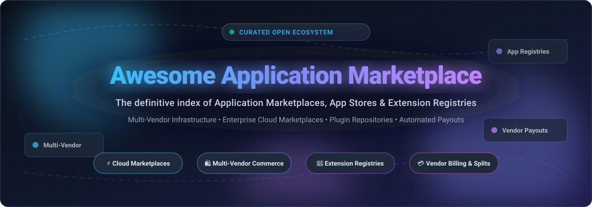

<div align="center">

<p align="center">
  
</p>

# 🛒 Awesome Application Marketplace 🚀

<p align="center">
  <strong>Curated Directory &amp; Architecture Guide for SaaS App Stores, Multi-Vendor Marketplaces, Extension Registries &amp; Vendor Payout Engines</strong>
</p>

<p align="center">
  <a href="https://github.com/ishandutta2007/Awesome-Awesome-Awesome"></a>
  <a href="https://discord.gg/jc4xtF58Ve"></a>
  <a href="https://github.com/ishandutta2007/Awesome-Application-Marketplace/stargazers"></a>
  <a href="https://github.com/ishandutta2007/Awesome-Application-Marketplace/network/members"></a>
  <a href="https://github.com/ishandutta2007/Awesome-Application-Marketplace/issues"></a>
  <a href="LICENSE"></a>
  <a href="https://github.com/ishandutta2007"></a>
</p>

<p align="center">
  <a href="#-sector-overview--market-dynamics">Sector Overview</a> •
  <a href="#-saashosted-platforms">Commercial Platforms</a> •
  <a href="#-open-source-github-projects">Open-Source Engines</a> •
  <a href="#-architecture--taxonomy-comparison">Architecture Comparison</a> •
  <a href="#-star-history">Star History</a> •
  <a href="#-support--sponsor">Support</a>
</p>

</div>

---

## 📌 Introduction & Scope

Welcome to **Awesome Application Marketplace** — the definitive open-source reference guide for developers, product managers, platform architects, and founders evaluating or building **software marketplaces**, **ecosystem app stores**, **extension registries**, and **multi-vendor commerce platforms**.

Whether you are scaling an ISV partner ecosystem (like Salesforce AppExchange or Atlassian Marketplace), establishing an enterprise cloud procurement pipeline (like AWS or Azure Marketplace), or launching a self-hosted multi-vendor store with automated vendor payouts and commission splitting, this repository curates verified data on costs, architectures, licensing, and trade-offs.

### 🎯 Key Focus Areas
- 🏢 **Enterprise SaaS & Cloud Marketplaces**: Hyperscalers and mega-SaaS application ecosystems with automated billing and co-sell workflows.
- 🛍️ **Multi-Vendor Commerce Engines**: Self-hosted, composable commerce engines capable of vendor onboarding, catalog federation, checkout splitting, and automated Stripe Connect payouts.
- 🧩 **Extension & Plugin Registries**: Developer-centric, vendor-neutral registries for IDE extensions, browser add-ons, and modular apps.
- ⚖️ **Transparent Financials**: Exact platform fee cuts, partner registration fees, revenue shares, and free-tier limits.

---

## 📑 Table of Contents

- [📊 Sector Overview & Market Dynamics](#-sector-overview--market-dynamics)
- [🏢 SaaS/Hosted Platforms](#-saashosted-platforms)
- [💻 Open-Source GitHub Projects](#-open-source-github-projects)
- [🏗️ Architecture & Taxonomy Comparison](#-architecture--taxonomy-comparison)
- [📈 Star History](#-star-history)
- [🤝 How to Contribute](#-how-to-contribute)
- [💖 Support & Sponsor](#-support--sponsor)
- [⚖️ Disclaimer](#-disclaimer)

---

## 📊 Sector Overview & Market Dynamics

The global application and cloud marketplace sector represents a multi-hundred-billion-dollar transactional ecosystem (with hyperscaler and B2B software marketplaces driving over $50B+ in software transactions within a $1T+ broader cloud market). The sector exhibits a distinct bifurcated structure: **moderately fragmented** across diverse vertical SaaS and developer tool niches, yet **highly concentrated** at the platform gatekeeper layer where hyperscalers (AWS, Microsoft, Google) and core enterprise ecosystem anchors (Salesforce, Shopify, Atlassian) create near 'winner-take-all' gravity through consolidated enterprise procurement and captive buyer networks.

---

## 🏢 SaaS/Hosted Platforms

| Company / Marketplace | Company Size (Market Cap / Valuation) | Exact Pricing & Take Rate | Free Tier / Trial Limit | Description & Ecosystem Fit |
| :--- | :--- | :--- | :--- | :--- |
| **[Microsoft Commercial Marketplace](https://azuremarketplace.microsoft.com/)** | ~$3.1T Market Cap | **3% standard store service fee** on transactable sales; 0% fee on BYOL (Bring Your Own License) listings; custom private offer renewals discounted by up to 50%. | **Free forever listing for BYOL/free apps**; paid transactable SaaS offers can configure custom **30-day or 90-day free trials**. | 🌐 Unified enterprise marketplace for Azure, Dynamics 365, Microsoft 365, and Power Platform solutions with enterprise MACC drawdown. |
| **[Google Workspace Marketplace](https://workspace.google.com/marketplace)** | ~$2.1T Market Cap (Alphabet) | **$0 developer registration fee**; **0% revenue share** (Google does not take a cut; developers bill independently via external processors such as Stripe). | **Free forever listing**; developers can publish unlimited free add-ons or manage their own external freemium/free trial tiers. | 📂 Official directory for Google Workspace add-ons (Docs, Sheets, Drive, Gmail) connecting to billions of Google Workspace accounts. |
| **[AWS Marketplace](https://aws.amazon.com/marketplace)** | ~$2.0T Market Cap (Amazon) | **3% listing fee** for SaaS and Data Exchange public offers (scales down to 2% for contracts $1M–$10M, 1.5% for $10M+ or renewals); 20% for AMI/container server products. | **Free forever tier for free/BYOL products**; paid SaaS listings can offer a **30-day free trial** with standard service quotas. | ☁️ Premier cloud marketplace for ISVs delivering solutions to AWS enterprise customers with consolidated EDP/PPA billing. |
| **[Salesforce AppExchange](https://appexchange.salesforce.com/)** | ~$280B Market Cap | **$150/year listing fee** per paid app + **$2,550+ one-time security review fee** per paid app submission; **15% Net Revenue Share (PNR)** under ISVforce (or 25% for OEM embedded apps). | **Free forever tier for 100% free apps** (exempt from the $150/yr listing fee and $2,550 security review fee); paid apps can offer a **30-day free trial**. | 💼 Enterprise app ecosystem for Salesforce CRM, featuring trusted partner tiering, enterprise procurement, and unified checkout. |
| **[ServiceNow Store](https://store.servicenow.com/)** | ~$190B Market Cap | **$5,000/year Technology Partner Program (TPP) fee** + **15% to 30% revenue share** on Store transactions (depending on partner-sourced vs. co-sell track). | **Free forever listing for internal/free utility integrations** (requires active TPP partner membership); paid apps can offer a **30-day free trial**. | ⚙️ Enterprise workflow marketplace for certified ServiceNow digital applications, ITOM/ITSM tools, and enterprise automation bots. |
| **[Shopify App Store](https://apps.shopify.com/)** | ~$115B Market Cap | **$19 one-time registration fee**; **0% revenue share on the first $1,000,000 USD** in lifetime gross revenue, then **15% revenue share** on revenue above $1M (+ 2.9% payment processing fee). | **Free forever tier for 100% free apps**; paid apps can set configurable free trials (commonly **7-day, 14-day, or 30-day free trial plans**). | 🛍️ Largest commercial commerce app directory with direct merchant billing integration across millions of Shopify storefronts. |
| **[Atlassian App Hub](https://marketplace.atlassian.com/)** | ~$45B Market Cap | **0% revenue share on first $1M lifetime revenue for Forge apps**, then **17% standard fee** (vendor keeps 83%); **25% fee for Connect apps** (vendor keeps 75%). | **Free forever tier for free apps** (apps free for all tiers or free up to 10 users); paid cloud apps include an automatic **30-day free trial**. | 🎯 Leading marketplace for Jira, Confluence, and Bitbucket plugins with native cloud Forge sandboxing and enterprise customer reach. |
| **[HubSpot App Marketplace](https://ecosystem.hubspot.com/marketplace/apps)** | ~$30B Market Cap | **$0 listing fee**; **0% revenue share** (HubSpot charges no commission on app sales; developers manage subscriptions directly via Stripe/external billing). | **Free forever listing**; developers can distribute completely free apps indefinitely or offer external trial periods without platform cut. | 🧲 CRM integration marketplace connecting third-party tools to millions of HubSpot marketing, sales, and service hubs. |
| **[Slack App Directory](https://slack.com/apps)** | ~$27.7B Acquisition (Salesforce) | **$0 developer registration fee**; **0% revenue share** (Slack does not process in-app payments; developers monetize externally via custom Stripe/SaaS billing). | **Free forever listing**; developers can offer free apps forever or external trial subscriptions mapped to Slack Workspace IDs. | 💬 Central discovery directory for Slack bots, webhooks, and productivity tools used across hundreds of thousands of workplaces. |
| **[Zendesk Marketplace](https://www.zendesk.com/marketplace/)** | ~$10.2B Private Acquisition (Hellman & Friedman) | **$0 listing fee**; **0% platform revenue share** (apps process payments directly through vendor-connected Stripe accounts; vendor pays standard Stripe fees). | **Free forever tier for free apps and themes**; paid apps feature a standardized **14-day free trial** managed via Stripe integration. | 🎧 Customer service and support app directory for Zendesk Support, Chat, and Sunshine platform extensions. |

---

## 💻 Open-Source GitHub Projects

Sorted in descending order by community stargazers:

- **[Medusa](https://github.com/medusajs/medusa)** [](https://github.com/medusajs/medusa/stargazers)
  - 🛠️ **Tech Stack**: Node.js, TypeScript, PostgreSQL, Redis (MIT License)
  - 📝 **Summary**: **Open-source headless commerce platform** — the foundation Mercur is built upon, offering composable commerce primitives for custom digital marketplaces.
  - ⚡ **Features**: Modular architecture with decoupled cart, payment, fulfillment, and pricing modules; API-first design; TypeScript native.
  - 🔄 **Trade-off**: Not a plug-and-play marketplace out of the box — vendor governance, split payments, and commission calculations require custom development or dedicated layers like Mercur.
  - 🎯 **Best For**: Developers building custom multi-vendor commerce engines from modular building blocks.

- **[Bagisto](https://github.com/bagisto/bagisto)** [](https://github.com/bagisto/bagisto/stargazers)
  - 🛠️ **Tech Stack**: PHP (Laravel), Vue.js, MySQL (MIT License)
  - 📝 **Summary**: **Enterprise-scale Laravel eCommerce and multi-vendor marketplace platform** with native seller administration.
  - ⚡ **Features**: Dedicated vendor portals, commission assignment per seller or category, product approval workflows, order splitting, and support for 10M+ SKUs.
  - 🔄 **Trade-off**: Requires full platform adoption rather than integrating as a microservice into an existing arbitrary backend.
  - 🎯 **Best For**: Laravel engineering teams seeking an all-in-one multi-vendor commerce and marketplace framework.

- **[Saleor](https://github.com/saleor/saleor)** [](https://github.com/saleor/saleor/stargazers)
  - 🛠️ **Tech Stack**: Python (Django), GraphQL, PostgreSQL (BSD-3-Clause)
  - 📝 **Summary**: **GraphQL-first headless commerce engine** with a dedicated Saleor App Store ecosystem.
  - ⚡ **Features**: Clean single GraphQL endpoint; official TypeScript/JavaScript SDKs; apps run isolated and integrate via webhook subscriptions and permission tokens.
  - 🔄 **Trade-off**: Focuses on modern commerce and app extensions; vendor payout automation and merchant escrow require custom integration.
  - 🎯 **Best For**: High-performance composable web architectures wanting an enterprise GraphQL app integration model.

- **[Spree](https://github.com/spree/spree)** [](https://github.com/spree/spree/stargazers)
  - 🛠️ **Tech Stack**: Ruby on Rails, Next.js / React, PostgreSQL (BSD-3-Clause)
  - 📝 **Summary**: **Battle-tested headless commerce and multi-vendor marketplace system** equipped with the `spree_multi_vendor` extension.
  - ⚡ **Features**: Separate vendor dashboards, configurable commissions, split shipments/orders across vendors, and modern Next.js storefronts with 0% platform take.
  - 🔄 **Trade-off**: Demands Ruby on Rails proficiency; requires configuration of the multi-vendor extension suite.
  - 🎯 **Best For**: Engineering teams wanting a proven, highly extensible Rails multi-vendor foundation.

- **[Vendure](https://github.com/vendure-ecommerce/vendure)** [](https://github.com/vendure-ecommerce/vendure/stargazers)
  - 🛠️ **Tech Stack**: TypeScript, NestJS, GraphQL, PostgreSQL / MySQL (MIT License)
  - 📝 **Summary**: **Modern headless commerce framework** built on NestJS and TypeScript with native multi-channel/multi-vendor capability.
  - ⚡ **Features**: Channel abstraction allows each vendor to operate as an independent channel with custom inventory, pricing, and role-based access; Stripe Connect plugin integration for split payouts.
  - 🔄 **Trade-off**: Requires developers to stitch multi-vendor channels to custom vendor management portals.
  - 🎯 **Best For**: Modern TypeScript/Node.js teams wanting a clean GraphQL architecture with enterprise-grade extensibility.

- **[F-Droid](https://github.com/f-droid/fdroidclient)** [](https://github.com/f-droid/fdroidclient/stargazers)
  - 🛠️ **Tech Stack**: Java / Kotlin, Android SDK, Python build scripts (GPL-3.0)
  - 📝 **Summary**: **The premier open-source application repository and client catalog for Android**.
  - ⚡ **Features**: Fully decentralized repository model; verifiable reproducible build system; anti-feature transparency tags; update delivery and client verification without tracking.
  - 🔄 **Trade-off**: Designed for open-source package distribution rather than commercial payment processing or vendor billing.
  - 🎯 **Best For**: Organizations, privacy distributions, and IoT fleets seeking independent, verifiable application distribution catalogs.

- **[Sharetribe](https://github.com/sharetribe/sharetribe)** [](https://github.com/sharetribe/sharetribe/stargazers)
  - 🛠️ **Tech Stack**: Ruby on Rails, React, MySQL (GPL-3.0)
  - 📝 **Summary**: **Pioneering peer-to-peer and multi-vendor marketplace engine** designed for rentals, services, and product listings.
  - ⚡ **Features**: Turnkey seller onboarding, booking/availability calendars, direct buyer-seller messaging, Stripe-powered payments, and administrative commission deductions.
  - 🔄 **Trade-off**: The community open-source codebase is based on classic Sharetribe architecture; modern Flex API features require SaaS licensing.
  - 🎯 **Best For**: Quick launches of rental, booking, or peer-to-peer service marketplaces.

- **[Open VSX](https://github.com/eclipse-openvsx/openvsx)** [](https://github.com/eclipse-openvsx/openvsx/stargazers)
  - 🛠️ **Tech Stack**: Java (Eclipse Vert.x), PostgreSQL, Redis (EPL-2.0)
  - 📝 **Summary**: **Vendor-neutral open-source extension registry** powering over 600M+ extension downloads per month for VS Code-compatible IDEs.
  - ⚡ **Features**: High-scale extension publishing, semantic versioning, search, public CLI, read-only mirrors, and TLS security hardening; adopted by Google Cloud, Salesforce, SAP, and Gitpod.
  - 🔄 **Trade-off**: Purpose-built for IDE extensions; excludes payment carts, subscriptions, and vendor payout logic.
  - 🎯 **Best For**: IDE creators, enterprise developer platforms, and cloud development environments needing an independent plugin registry.

- **[Mercur](https://github.com/mercurjs/mercur)** [](https://github.com/mercurjs/mercur/stargazers)
  - 🛠️ **Tech Stack**: Node.js (MedusaJS 2.0), TypeScript, PostgreSQL, Redis
  - 📝 **Summary**: **Purpose-built open-source multi-vendor marketplace engine** with native Stripe Connect split payouts.
  - ⚡ **Features**: Dedicated vendor management portals; offer-based selling against master catalogs; split checkout with automated commission calculations; scheduled Stripe Connect transfers; 0% GMV platform tax.
  - 🔄 **Trade-off**: Focused on multi-vendor retail and physical/digital products rather than sandboxed app packages or cloud manifests.
  - 🎯 **Best For**: Operators needing complete source ownership of an enterprise multi-vendor commerce portal with automated vendor payouts.

- **[GrandNode](https://github.com/grandnode/grandnode2)** [](https://github.com/grandnode/grandnode2/stargazers)
  - 🛠️ **Tech Stack**: C# (.NET Core 10), MongoDB / DocumentDB / CosmosDB (GPL-3.0)
  - 📝 **Summary**: **Cross-platform .NET eCommerce and multi-vendor platform** built natively on document-oriented NoSQL storage.
  - ⚡ **Features**: Out-of-the-box multi-vendor, multi-tenant, and multi-store support; B2B quote workflows; vendor product sub-catalogs.
  - 🔄 **Trade-off**: Coupled to the .NET/MongoDB ecosystem.
  - 🎯 **Best For**: Enterprise .NET development teams looking for a NoSQL-driven multi-vendor platform.

- **[ownCloud Marketplace](https://github.com/owncloud/marketplace)** [](https://github.com/owncloud/marketplace/stargazers)
  - 🛠️ **Tech Stack**: Static Site Generation, Git Repository Automation
  - 📝 **Summary**: **Backend-free, Git-backed application catalogue** where app publishing is executed entirely via Pull Requests.
  - ⚡ **Features**: Zero runtime database, zero servers; static JSON catalogue; community code reviews in public on GitHub; immutable releases.
  - 🔄 **Trade-off**: Catalog distribution only; no payment processing or developer billing.
  - 🎯 **Best For**: Open-source foundations and privacy projects wanting an un-hackable, auditable, serverless plugin catalog.

---

### 📦 Additional Open-Source Concepts & Specifications
- 🌐 **Mobazha**: Decentralized peer-to-peer commerce and storefront protocol (Go) with multi-cryptocurrency settlements.
- 📐 **AppNest**: Comprehensive app store specification (Codeberg) detailing governance, moderation, and API contracts for cross-platform app ecosystems.
- 🔗 **Open Store**: Blockchain-anchored application registry exploration.
- 🧱 **Gerege Nexus App Store**: Modular Go app registry microservices (auth, review, discovery).

---

## 🏗️ Architecture & Taxonomy Comparison

When planning an application marketplace, choosing between the three primary architectural archetypes is essential:

```
┌─────────────────────────────────────────────────────────────────────────────┐
│                       APPLICATION MARKETPLACE ARCHETYPES                    │
├──────────────────────────┬──────────────────────────┬───────────────────────┤
│   Hyperscaler / SaaS     │   Multi-Vendor Commerce  │  Extension / Plugin   │
│   Ecosystem Hub          │   Engine                 │  Registry             │
├──────────────────────────┼──────────────────────────┼───────────────────────┤
│ • Salesforce, AWS, MSFT  │ • Mercur, Medusa, Spree  │ • Open VSX, F-Droid   │
│ • Deep buyer networks    │ • Vendor onboarding      │ • Package validation  │
│ • Integrated co-sell     │ • Split checkout / cart  │ • Versioned manifests │
│ • Mandatory security rev │ • Automated commissions  │ • Static / federated  │
│ • 3% - 25% take rates    │ • Stripe Connect payouts │ • 0% fee (discovery)  │
└──────────────────────────┴──────────────────────────┴───────────────────────┘
```

---

## 📈 Star History

[](https://star-history.dera.page/#ishandutta2007/Awesome-Application-Marketplace&type=date&legend=top-left)

---

## 🤝 How to Contribute

Contributions are warmly welcomed! Help keep this directory accurate, up to date, and vendor-friendly:

1. 🍴 **Fork** this repository.
2. 🌿 **Create a new branch** (`git checkout -b feature/new-marketplace`).
3. 📝 **Add or edit entries** in `README.md` following the established table or project format (ensure exact pricing and free tier specs are included).
4. 🚀 **Commit your changes** (`git commit -m 'Add New Marketplace'`).
5. 📬 **Open a Pull Request** with a clear rationale and verification links.

---

## 💖 Support & Sponsor

Thank you for exploring **Awesome Application Marketplace**! 🌟

If you found this curated guide, architectural comparison, or fee breakdown valuable:
- ⭐ **Star this repository** on GitHub to help others discover it.
- 🍴 **Fork and share** it with your developer and platform teams.
- ☕ **Buy a coffee & sponsor ongoing maintenance** via the [GitHub Sponsor Dashboard](https://github.com/sponsors/ishandutta2007).

Your support enables continuous tracking of marketplace fee changes, platform releases, and emerging open-source engines!

---

## ⚖️ Disclaimer

- This is an independent, **community-curated** list — listings do not constitute commercial endorsement.
- Application marketplaces managing developer credentials, API tokens, and customer billing data must comply with relevant data protection legislation (GDPR, CCPA) and PCI DSS compliance standards.
- Marketplace fees and partner policies are subject to ongoing updates by operators. Validate pricing with official developer documentation prior to commercial release.

---

<div align="center">

**Built with ❤️ for platform teams, developers, and organizations crafting transparent application marketplaces.**

</div>
